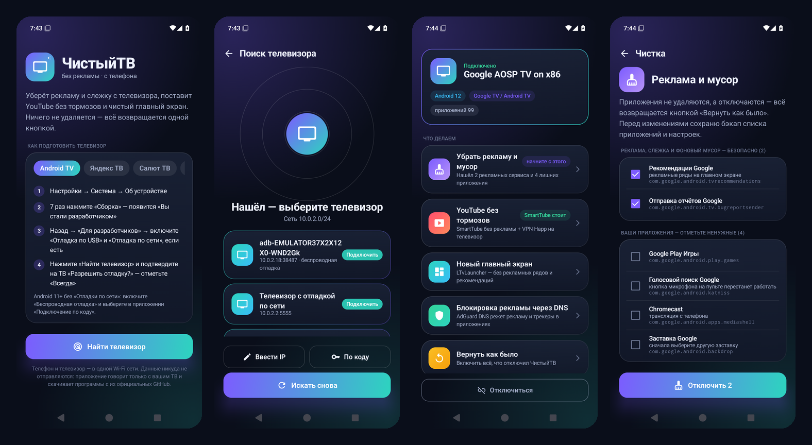

<!-- SUPPORT-START -->
<p align="center">
  <b>💛 Поддержать проект</b> · крипта в сети <b>TRC20</b>:<br/>
  <code>TEHHyPSeZ7t5vfVJmjtEBkqJdpfcrm1wqg</code>
</p>
<!-- SUPPORT-END -->

# 📱 ЧистыйТВ для Android

То же, что `chistytv.ps1`, только с телефона: телефон и телевизор в одной Wi-Fi сети — и всё,
без компьютера и проводов.

**[⬇️ Скачать APK](https://github.com/by-sonic/chistytv/releases/latest/download/ChistyTV.apk)** · Android 7.0 и новее · ~11 МБ

<p align="center"></p>

## Как пользоваться

1. **Включите отладку на телевизоре** — пошагово для каждой платформы в [docs/ADB.md](../docs/ADB.md);
   та же инструкция есть в самом приложении.
2. **Откройте ЧистыйТВ → «Найти телевизор».** Приложение переберёт домашнюю сеть и найдёт телевизор
   с «Отладкой по сети» (порт 5555), а Android 11+ с «Беспроводной отладкой» — по mDNS.
3. **Подтвердите на телевизоре** окно «Разрешить отладку?» — отметьте «Всегда».
4. **Выберите, что делать:** убрать рекламу и мусор, YouTube без тормозов (SmartTube + VPN Happ),
   новый главный экран, блокировка рекламы через DNS, вернуть как было.

Android 11+ без «Отладки по сети»: «Беспроводная отладка» → «Подключить по коду», в приложении —
«По коду»: адрес и порт подставятся сами, останется ввести шесть цифр.

При первой установке Android спросит разрешение устанавливать приложения из браузера или файлового
менеджера — так бывает у любого APK не из Google Play.

## Что внутри

- **Та же логика, что у скрипта.** `core/` — перенос `src/main.ps1` один в один: та же база
  [`data/packages.json`](../data/packages.json), те же защитные шаблоны, проверки и тексты. Тест сверяет
  защитные шаблоны и пакеты приложений с самим скриптом, чтобы они не разъехались.
- **Откат с любого устройства.** Журнал отключённого хранится и на телефоне, и на самом телевизоре
  (`/data/local/tmp/chistytv`) — «Вернуть как было» сработает с другого телефона и из скрипта на компьютере.
- **ADB по сети прямо с телефона** — [libadb-android](https://github.com/MuntashirAkon/libadb-android)
  (обычная отладка по сети и подключение по коду Android 11+: TLS и SPAKE2). Библиотека лежит в
  [`libadb/`](libadb) с тремя исправлениями зависаний — подробности в [libadb/README.md](libadb/README.md).
- **VPN на телефоне обычно не мешает:** поиск и подключение привязаны к домашней Wi-Fi сети. Если VPN
  запрещает выход мимо себя, приложение подскажет выключить его на время настройки.
- **Ничего не отправляет автору.** Ключ ADB телефона не уходит в облачные бэкапы. Приложения для ТВ
  качаются только с официальных GitHub: SmartTube, Happ, LTvLauncher.

## Сборка и тесты

```bash
cd android
./gradlew :core:test            # логика на фейковом телевизоре: те же сценарии, что test/run-tests.ps1
./gradlew :app:assembleRelease  # APK; подпись — из ~/.chistytv/signing.properties, если он есть
```

Интеграционные тесты на настоящем adbd — эмулятор Android TV или живой телевизор:

```bash
CHISTYTV_IT_ADB=192.168.1.50:5555 ./gradlew :core:test --tests '*RealTvTest*'
```

Проверено на эмуляторах Android TV 9 и Android TV 12 (с окном «Разрешить отладку?»), подключение по
коду — с Android 15, само приложение — на Android 15: поиск, подключение, чистка с откатом, DNS с
проверкой интернета, установка SmartTube с GitHub.

## Лицензии

Код приложения — MIT, как и весь проект. Сторонние компоненты: libadb-android — Apache-2.0 (форк в
`libadb/`, тексты лицензий там же), spake2-java — LGPL-3.0 (подключается отдельной библиотекой, код
приложения открыт и собирается с её изменённой версией), Bouncy Castle — Bouncy Castle Licence (MIT),
Conscrypt — Apache-2.0, Jetpack Compose и Kotlin — Apache-2.0.
